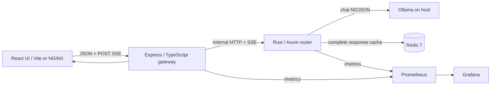

# LLM Router

A self-hosted, contracts-first gateway that routes local Ollama chat requests to a light, code, or heavy model tier; streams responses over SSE; caches complete, low-temperature answers in Redis; and exposes routing, latency, and benchmark information in a React UI.

> **Honest status:** the TypeScript gateway, React app, mocks, contracts, and benchmark harness have automated checks. The Rust router has not been compiled in this workspace because `cargo`/`rustc` are unavailable; Docker and a target Ollama/GPU are also unavailable here. No hardware benchmark results are claimed. See [acceptance status](docs/acceptance-status.md).

## Quick start — no GPU required

Requires Node.js 24.22.0 (or compatible Node 24 LTS) and npm 11. From the repository root:

```bash
npm ci
npm run dev:mock
```

Open <http://localhost:5173>. The development mock stack runs the deterministic Node mock-router, gateway, and Vite UI; it exercises the browser-to-gateway SSE path without Ollama or Redis. It is a development/test double, not an inference or performance result.

### Full Compose stack with the Ollama-compatible mock

Requires Docker Engine/Desktop and Compose v2. This builds the Rust router image and runs Redis plus the mock Ollama server; it does not download model weights or require a GPU.

```bash
docker compose --env-file .env.mock --profile mock up --build
```

Open <http://localhost:8080>. Internal router and Redis ports are not published to the host. Stop with `Ctrl+C`, or run `docker compose --env-file .env.mock --profile mock down` in another terminal.

> The Compose/Rust path is provided but has not been locally verified in this environment. The local TypeScript mock command above does not compile or test Rust.

## Run with local Ollama

1. Install Ollama and pull the model tags listed in [`config/models.yaml`](config/models.yaml). Model weights are intentionally not included in this repository.
2. Ensure the Ollama API is reachable from the gateway/router process. For containers on Linux, Compose adds `host.docker.internal:host-gateway`; Ollama may need to bind to a host interface reachable from Docker (commonly `OLLAMA_HOST=0.0.0.0:11434`). Restrict this with the host firewall to trusted local interfaces—do not expose Ollama publicly.
3. Copy `.env.example` to `.env`, set `COMPOSE_OLLAMA_URL` and `COMPOSE_CORS_ORIGINS` as needed, then start:

```bash
cp .env.example .env
docker compose up --build
```

The UI is at <http://localhost:8080>. The default Compose path uses the Rust router, host Ollama, and internal Redis. For local source development with real Rust routing, run Redis separately, start Ollama, then use `npm run dev` from a Rust-enabled environment.

## Mock, observability, and Kubernetes options

- **Rust router + mock Ollama in Compose:** `docker compose --env-file .env.mock --profile mock up --build`.
- **All-Node mock router in Compose** (does not build Rust): `docker compose -f docker-compose.yml -f deploy/docker-compose.mock-router.yml up --build`.
- **Prometheus + Grafana:** set a local `GRAFANA_ADMIN_PASSWORD`, then run `docker compose -f docker-compose.yml -f deploy/docker-compose.observability.yml up --build`. Prometheus: <http://localhost:9090>; Grafana: <http://localhost:3001>. The GPU exporter is an optional `gpu` profile and requires NVIDIA Container Toolkit/GPU support.
- **Kubernetes (Kustomize):** see [`deploy/k8s/README.md`](deploy/k8s/README.md) and `deploy/k8s/scripts/`. The `dev` overlay deploys the mock Ollama service; real Ollama stays outside the cluster by default.

## Useful commands

| Command | Purpose |
|---|---|
| `npm ci` | Install the pinned npm workspace dependencies |
| `npm run dev:mock` | Start mock-router, gateway, and frontend source servers |
| `npm test` | Run gateway, frontend, and mock-Ollama tests |
| `npm run lint` | Lint gateway and frontend |
| `npm run typecheck` | Typecheck gateway, frontend, and benchmark runner |
| `npm run build` | Build gateway and frontend |
| `npm run contracts:check` | Validate OpenAPI, schema fixtures, and YAML configuration |
| `npm run gen:types` | Regenerate gateway/frontend OpenAPI types |
| `npm run bench:typecheck` | Typecheck the benchmark harness |
| `npm run bench` | Run benchmark A/B/C against a reachable gateway (full set by default) |
| `cargo test --manifest-path router/Cargo.toml --locked` | Rust unit tests (requires Rust toolchain) |
| `cargo fmt --manifest-path router/Cargo.toml -- --check` | Rust formatting gate |
| `cargo clippy --manifest-path router/Cargo.toml --all-targets --locked -- -D warnings` | Rust lint gate |

To exercise the harness against a local mock stack without creating a publishable model-performance result, set `BENCH_LIMIT=6 BENCH_RESULTS_DIR=bench/.smoke-results` and remove that temporary output afterward. Results are stored as JSON under `bench/results/` by default; a mock run is clearly labeled and must not be presented as hardware inference performance.

## What is included

- **Rust router:** Axum API, Ollama NDJSON/SSE streaming, classifier/policy, model queues/fallback, Redis cache, health, metrics, stats, and Criterion classifier benchmark.
- **Node gateway:** Express/TypeScript validation, request IDs, rate limiting, structured logging, CORS/security headers, SSE proxy, stats, benchmark endpoints, and Prometheus metrics.
- **React UI:** Chat, live dashboard, benchmark comparison, and settings pages; typed API/SSE clients and responsive dark/light styling.
- **Contracts/config:** OpenAPI 3.1, JSON Schemas/fixtures, generated TypeScript types, YAML model/routing/server/gateway/frontend/benchmark defaults.
- **Deployment:** multi-stage Dockerfiles, Compose profiles, NGINX SSE proxy settings, Prometheus/Grafana provisioning, and Kustomize base/dev overlay.
- **Tests/mocks:** deterministic mock Ollama API, deterministic mock router, gateway/frontend tests, and a labeled 72-case benchmark dataset.

## Architecture at a glance



See [`Architecture.md`](Architecture.md) for module boundaries, lifecycle, policy, and deployment trade-offs; [`contracts/sse-events.md`](contracts/sse-events.md) for stream semantics.

## Configuration

Edit the YAML under `config/` for model registry, policy thresholds/weights, runtime defaults, and benchmark methodology. Environment overrides are listed in [`.env.example`](.env.example) and described in [`docs/configuration.md`](docs/configuration.md). Do not commit `.env` or secrets.

The initial model tags are examples; change them to match models installed in your Ollama instance. The classifier is deterministic and explainable, not an LLM-based quality judge.

## Security and privacy

The intended use is a trusted, local, single-user development environment. The gateway enforces request limits and rate limiting, CORS is allow-listed, container services are internal by default, prompts are not logged at info level, and the UI sanitizes Markdown. There is no API-key authentication or multi-tenant isolation in this version. Do not expose the gateway, Redis, Ollama, or Grafana to an untrusted network without adding appropriate authentication and network controls. More detail: [`SECURITY.md`](SECURITY.md).

## Documentation index

- [Product requirements](prd.md) · [Architecture](Architecture.md) · [UI design](Design.md)
- [Engineering rules](Rules.md) · [Task plan](Tasks.md) · [Memory/decisions](Memory.md)
- [API contract](contracts/openapi.yaml) · [SSE contract](contracts/sse-events.md)
- [Benchmark method](docs/benchmark-methodology.md) · [Configuration reference](docs/configuration.md)
- [Operations & deployment](docs/operations.md) · [Demo script](docs/demo-script.md)
- [Acceptance status and known limitations](docs/acceptance-status.md)

## License

MIT. See [`LICENSE`](LICENSE).
