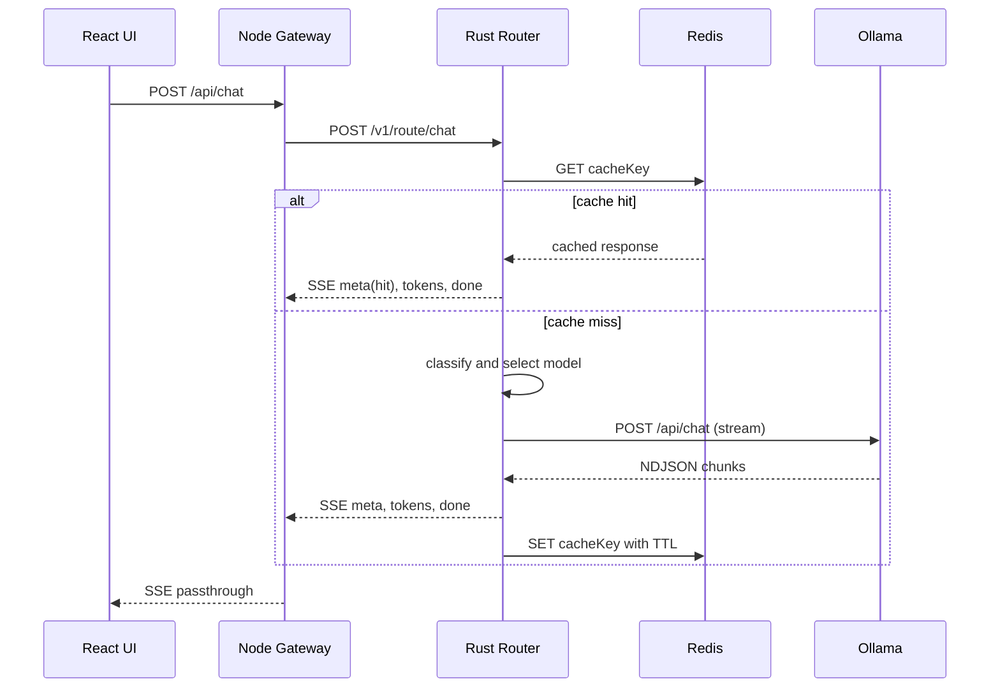
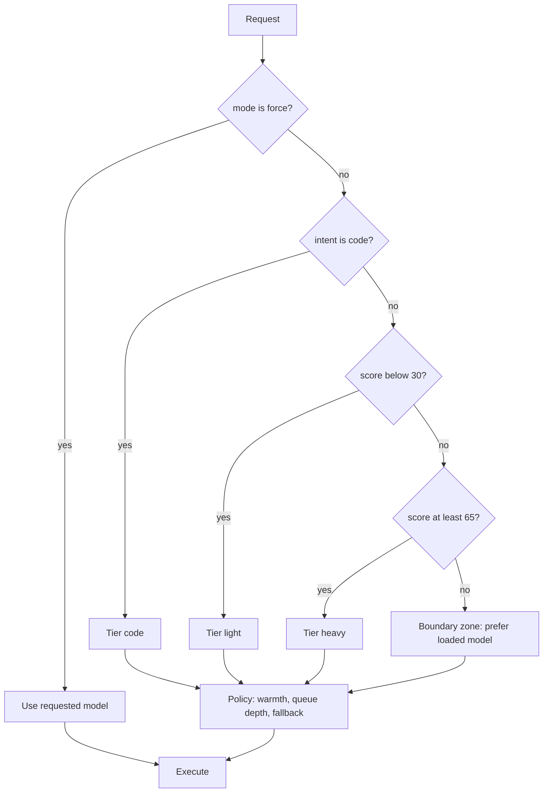

# Architecture — LLM Router

Companion docs: `prd.md` (what/why), `Design.md` (UI), `Rules.md` (how we build), `Tasks.md` (work), `Memory.md` (shared agent context).

---

## 1. Architectural Overview

```
┌──────────────────────┐
│   React Frontend     │  Chat · Dashboard · Benchmark
│   (Vite + TS)        │
└─────────┬────────────┘
          │ HTTP/JSON + SSE (POST streaming via fetch)
┌─────────▼────────────┐
│  Node.js Gateway     │  Validation · rate limit · request IDs · SSE piping · stats fan-out
│  (Express + TS)      │
└─────────┬────────────┘
          │ HTTP + SSE (internal network)
┌─────────▼──────────────────────────────────────────────────────┐
│                  Rust Routing Engine (axum)                     │
│  api ─► cache ─► classifier ─► policy ─► queue ─► ollama client │
│                         │                                       │
│                    metrics / stats                              │
└───────┬────────────────────┬──────────────────────┬─────────────┘
        │                    │                      │
  ┌─────▼─────┐      ┌───────▼────────┐      ┌──────▼───────┐
  │  Redis 7  │      │ Ollama (host)  │      │ /metrics     │──► Prometheus ──► Grafana
  │ cache     │      │ light/code/    │      └──────────────┘            ▲
  └───────────┘      │ heavy models   │      nvidia_gpu_exporter ────────┘
                     └────────────────┘
```

**Design principles**
1. **Router is the brain; gateway is a thin edge.** All model-selection logic lives in Rust.
2. **Contracts first.** HTTP/SSE shapes defined in `contracts/` before implementation.
3. **Everything configurable.** Models, thresholds, TTLs in YAML/env.
4. **Hardware-aware.** Decisions consider what is currently loaded in 6 GB VRAM.
5. **Observable by default.** Every decision and inference produces metrics.
6. **Testable without a GPU.** `tools/mock-ollama` mimics Ollama's streaming API.

---

## 2. Components

### 2.1 React Frontend (`/frontend`)
| Concern | Detail |
|---------|--------|
| Pages | Chat (`/`), Dashboard (`/dashboard`), Benchmark (`/benchmark`), Settings (`/settings`) |
| Data | Streaming chat via `fetch` + `ReadableStream` SSE parser; dashboard via SSE `/api/stats/stream`; REST via TanStack Query |
| State | Zustand (chat session, settings); TanStack Query (server state) |
| Rule | No routing logic; only displays decisions returned by the backend |

### 2.2 Node.js Gateway (`/gateway`)
| Concern | Detail |
|---------|--------|
| Role | Public API surface; validation (zod); rate limiting; request ID; CORS/helmet; SSE passthrough; stats fan-out |
| Upstream | `undici` streaming to router; aborts upstream when client disconnects |
| Does not | Choose models, cache responses, call Ollama |

### 2.3 Rust Router (`/router`)

| Module | Responsibility |
|--------|----------------|
| `api/` | axum handlers: `chat`, `preview`, `models`, `stats`, `cache`, `health`, `metrics` |
| `cache/` | key normalization + hashing, Redis store, replay stream |
| `classifier/` | feature extraction, scoring, intent detection |
| `policy/` | tier→model selection, warm-model stickiness, queue-aware diversion, fallback chain |
| `queue/` | per-model `tokio::sync::Semaphore`, depth gauges |
| `ollama/` | HTTP client, NDJSON stream parser, `/api/ps` poller, typed responses |
| `metrics/` | Prometheus registry, rolling-window stats, recent-decisions ring buffer |
| `config.rs` | YAML + env loading, validation, hot-reload (stretch) |
| `error.rs` | `thiserror` error enum mapped to HTTP/SSE errors |

**Trait boundaries (for testability)**
```rust
trait Classifier   { fn classify(&self, req: &ChatRequest) -> Classification; }
trait Selector     { fn select(&self, c: &Classification, s: &SystemState) -> RouteDecision; }
trait CacheStore   { async fn get(&self, k: &CacheKey) -> Result<Option<CachedResponse>>;
                     async fn set(&self, k: &CacheKey, v: &CachedResponse, ttl: Duration) -> Result<()>; }
trait LlmBackend   { async fn chat_stream(&self, model: &str, req: &ChatRequest)
                       -> Result<BoxStream<'static, Result<LlmChunk>>>;
                     async fn loaded_models(&self) -> Result<Vec<LoadedModel>>; }
```
Real impls: `RedisCache`, `OllamaBackend`. Test impls: `InMemoryCache`, `FakeBackend` (or wiremock).

### 2.4 Redis (cache + optional stats)
- Plain Redis 7; `maxmemory 256mb`, `maxmemory-policy allkeys-lru`.
- `redis-stack` only if semantic cache (stretch) is built.

### 2.5 Ollama (host)
- Runs on host to use the RTX 4050. Containers reach it at `host.docker.internal:11434`.
- Settings: `OLLAMA_MAX_LOADED_MODELS=1`, `OLLAMA_NUM_PARALLEL=1`, `OLLAMA_KEEP_ALIVE=10m`; request `options.num_ctx=4096`.

### 2.6 Observability Stack
Prometheus scrapes router `/metrics`, gateway `/metrics`, GPU exporter. Grafana has provisioned dashboards. React dashboard consumes JSON stats via the gateway (not Prometheus directly).

---

## 3. Request Lifecycle



**Request state machine (router):**
`Received → CacheLookup → (Hit → Replay → Done) | (Miss → Classified → Selected → Queued → Streaming → Completed → Cached → Done)`; any state may transition to `Error`, and `Streaming/Queued` may transition to `Fallback → Queued`.

**Cancellation:** when the client disconnects, gateway aborts the upstream request; router drops the stream, which cancels the Ollama HTTP call and releases the semaphore permit (via RAII guard).

---

## 4. Routing Algorithm



### 4.1 Features → score
```
score = clamp( 0.35*length + 0.30*reasoning + 0.20*structure + 0.15*context - 0.25*simplicity , 0, 100 )
```
Each sub-score is normalized 0–100. Weights, keyword lists and thresholds live in `config/routing.yaml`.

| Feature | Source |
|---------|--------|
| length | estimated tokens (`chars/4`) of latest user message |
| reasoning | hits of reasoning keywords (compare, analyze, design, trade-off, step by step, derive, evaluate…) |
| structure | number of questions, numbered lists, multi-part asks |
| context | conversation length, long pasted text |
| simplicity | greeting patterns, < 12 tokens, define/translate/"what is" |
| intent=code | code fences, language keywords, stack traces, words like debug/refactor/regex/SQL |

### 4.2 Policy rules (in order)
1. **Force override** (`mode=force`) wins.
2. **Warm-model stickiness:** if chosen model ≠ loaded model and `|score − nearest_boundary| ≤ 8`, keep the loaded model. Never override `intent=code`.
3. **Queue diversion:** if target queue depth > `max_queue` and an adjacent tier is idle and acceptable, divert.
4. **Fallback chain** on timeout/OOM/5xx: one retry on `fallback[tier]`; emit updated `meta`.
5. Record `reason` string describing the chain of decisions (shown in UI).

### 4.3 Evolution
v1 rules/scoring → v2 policy layer (warmth, queues, fallback) → v3 optional learned/embedding classifier trained on benchmark logs.

---

## 5. Data Models

### 5.1 Core types (Rust, serialized with serde)
```rust
struct ChatRequest { messages: Vec<Message>, mode: Mode, model: Option<String>,
                     options: Options, use_cache: bool, request_id: Uuid }
struct Message { role: Role, content: String }
struct Classification { score: u8, intent: Intent, reasons: Vec<String>, est_tokens: u32 }
struct RouteDecision { model: String, tier: Tier, reason: String, swap_expected: bool, fallback: Option<String> }
struct Usage { prompt_tokens: u32, completion_tokens: u32, ttft_ms: u64, total_ms: u64,
               tokens_per_sec: f32, load_ms: u64 }
struct CachedResponse { text: String, model: String, tier: Tier, usage: Usage, created_at: DateTime<Utc> }
```

### 5.2 Redis key schema
| Key | Type | TTL | Content |
|-----|------|-----|---------|
| `llmr:resp:<sha256>` | string (JSON) | `CACHE_TTL_SECONDS` | `CachedResponse` |
| `llmr:stats:hits` / `:misses` | counter | none | cache counters |
| `llmr:inflight:<sha256>` (stretch) | string | 120 s | single-flight lock |

**Cache key** = `sha256( normalize(messages) + system + temperature + top_p + num_ctx )`. Normalization: trim, collapse whitespace, Unicode NFC, lowercase for key only (stored text unchanged). The key is model-independent.

### 5.3 SSE event schema
See `contracts/sse-events.md` (canonical). Events: `meta`, `token`, `done`, `error`. `meta` may be emitted twice (initial + after fallback).

### 5.4 Ollama fields consumed
`/api/chat` stream chunks (`message.content`, `done`), final chunk: `total_duration`, `load_duration`, `prompt_eval_count`, `prompt_eval_duration`, `eval_count`, `eval_duration` (ns). `/api/ps`: loaded models, `size_vram`, `expires_at`.

---

## 6. API Surface

Canonical: `contracts/openapi.yaml`. Summary:

| Layer | Endpoints |
|-------|-----------|
| Client → Gateway | `POST /api/chat`, `POST /api/route/preview`, `GET /api/models`, `GET /api/stats`, `GET /api/stats/stream`, `POST /api/benchmark/run`, `GET /api/benchmark/results`, `POST /api/cache/flush`, `GET /api/health` |
| Gateway → Router | `POST /v1/route/chat`, `POST /v1/route/preview`, `GET /v1/models`, `GET /v1/stats`, `POST /v1/cache/flush`, `GET /healthz`, `GET /metrics` |

**Error envelope (JSON, non-stream):** `{ "error": { "code": "...", "message": "...", "request_id": "..." } }`
**Error codes:** `INVALID_REQUEST`, `RATE_LIMITED`, `UPSTREAM_TIMEOUT`, `UPSTREAM_UNAVAILABLE`, `MODEL_NOT_FOUND`, `QUEUE_FULL`, `INTERNAL`.

---

## 7. Concurrency & Performance Model

- **Runtime:** tokio multi-thread; handlers are async; CPU-bound classification is O(prompt length) and runs inline (< 1 ms).
- **Per-model semaphore** (`max_concurrency`, default 1) gates Ollama calls; permit held by RAII guard for the stream's lifetime.
- **Streaming tee:** stream chunks are forwarded to the client while text is appended to an in-memory buffer; after `done`, buffer is written to Redis in a spawned task (does not delay `done`).
- **Backpressure:** bounded channel between Ollama reader and SSE writer; slow clients cannot grow memory unbounded.
- **Loaded-model state:** `/api/ps` polled every 2 s and updated after each request; stored in `Arc<RwLock<SystemState>>`.
- **Budgets:** classify < 1 ms; router overhead p95 < 20 ms; cache-hit TTFT < 50 ms.

---

## 8. Failure Modes & Handling

| Failure | Detection | Response |
|---------|-----------|----------|
| Redis down | connection error | Bypass cache (log warn, metric), continue serving |
| Ollama unreachable | connect error / health check | `error` event `UPSTREAM_UNAVAILABLE`; `/api/health` degraded |
| Model not pulled | 404 from Ollama | `MODEL_NOT_FOUND`; fallback tier if configured |
| Generation timeout | per-tier timeout | Cancel, fallback once, else `UPSTREAM_TIMEOUT` |
| Queue full | depth > limit | Divert or `QUEUE_FULL` (HTTP 429/503) |
| Client disconnects | stream closed | Cancel upstream, release permit, do not cache partial |
| Invalid config | startup validation | Fail fast with clear message |
| OOM / CPU fallback in Ollama | `size_vram` < `size` in `/api/ps` | Warn metric `llmr_partial_offload`; route lighter if possible |

---

## 9. Technology Stack (essential libraries by phase)

> Versions: use the latest stable at Phase 0 and **pin** (`Cargo.lock`, `package-lock.json`). Record chosen versions in `Memory.md`.

### 9.1 Rust router
| Library | Purpose | Needed from |
|---------|---------|-------------|
| `tokio` | async runtime | P1 |
| `axum`, `tower`, `tower-http` | HTTP server, middleware (trace, cors, timeout) | P1 |
| `reqwest` (json, stream) | Ollama client | P1 |
| `serde`, `serde_json`, `serde_yaml` | (de)serialization, config | P1 |
| `futures`, `tokio-stream`, `async-stream`, `bytes` | stream plumbing | P1 |
| `config`, `dotenvy` | configuration | P1 |
| `thiserror`, `anyhow` | errors | P1 |
| `tracing`, `tracing-subscriber` | structured logs | P1 |
| `uuid`, `chrono` | IDs, timestamps | P1 |
| `redis` (tokio-comp, connection-manager) | cache | P2 |
| `sha2`, `hex`, `unicode-normalization` | cache key | P2 |
| `regex`, `once_cell` | classifier features | P3 |
| `prometheus` (or `metrics` + exporter) | metrics | P4 |
| `dashmap`, `parking_lot` | shared state | P4–5 |
| Dev: `wiremock`, `tokio-test`, `criterion`, `testcontainers` (opt.), `insta` (snapshot, opt.) | tests/bench | P1+ |
| Stretch: `fastembed` / Ollama embeddings | semantic cache | P11 |

### 9.2 Node.js gateway (Node 22/24 LTS, TypeScript strict)
| Package | Purpose | From |
|---------|---------|------|
| `express`, `cors`, `helmet` | server/security headers | P1 |
| `zod` | request validation | P1 |
| `undici` | streaming upstream calls | P1 |
| `pino`, `pino-http` | logging | P1 |
| `dotenv` | env | P1 |
| `express-rate-limit` | rate limiting | P2 |
| `prom-client` | metrics | P4 |
| `openapi-typescript` | types from contract | P0 |
| Dev: `typescript`, `tsx`, `vitest`, `supertest`, `eslint`, `prettier` | tooling | P0+ |

### 9.3 React frontend
| Package | Purpose | From |
|---------|---------|------|
| `react`, `react-dom`, `vite`, `typescript` | app/build | P1 |
| `tailwindcss` | styling | P1 |
| `react-router-dom` | routing | P1 |
| `@tanstack/react-query` | server state | P2 |
| `zustand` | client state | P1 |
| `react-markdown`, `remark-gfm`, `rehype-highlight` | message rendering | P1 |
| `lucide-react` | icons | P1 |
| `recharts` | charts | P6 |
| `clsx`, `tailwind-merge` | class utilities | P1 |
| Dev: `vitest`, `@testing-library/react`, `jsdom`, `playwright` (E2E), `eslint`, `prettier` | tests/tooling | P1+ |

### 9.4 Infrastructure & tooling
| Tool | Purpose | From |
|------|---------|------|
| Docker, Compose v2 | containers | P0 / P8 |
| Redis 7 image | cache | P0 |
| Prometheus, Grafana | metrics/dashboards | P4 |
| `nvidia_gpu_exporter` | VRAM/GPU metrics | P4 |
| `cargo-chef` | Rust image layer caching | P8 |
| nginx | serve built UI + `/api` proxy (buffering off) | P8 |
| k3d or minikube, `kubectl`, Kustomize, `metrics-server` | Kubernetes | P9 |
| `k6` or `autocannon` | load testing | P7/P9 |
| GitHub Actions | CI | P10 |
| `openapi-typescript`, optional `spectral` | contract tooling / lint | P0 |

---

## 10. Deployment Topologies

### 10.1 Local dev (no Docker for app code)
`ollama serve` (host) · `redis` (docker) · `cargo run` (router) · `npm run dev` (gateway, frontend). Use `mock-ollama` profile when no GPU.

### 10.2 Docker Compose
```
services: frontend(nginx:8080) → gateway:3000 → router:8081 → redis:6379
                                                  └→ host.docker.internal:11434 (Ollama)
overlay:  prometheus:9090, grafana:3001, gpu-exporter:9835
profile:  mock-ollama (replaces host Ollama for CI)
```
Health checks on every service; `depends_on: condition: service_healthy`.

### 10.3 Kubernetes (local k3d/minikube)
| Resource | Notes |
|----------|-------|
| Namespace `llm-router` | isolation |
| ConfigMaps | `models.yaml`, `routing.yaml` |
| Secrets | (placeholder) API keys / Grafana admin |
| Deployments | frontend, gateway, router (probes on `/healthz`, requests/limits) |
| Redis | StatefulSet + PVC (or Deployment for dev) |
| Services/Ingress | ClusterIP + Ingress for frontend/gateway |
| Ollama | `ExternalName`/Endpoints → host (GPU stays on host) |
| HPA | gateway on CPU; router limited to 1–2 replicas |
| Optional | `kube-prometheus-stack` + ServiceMonitors |

**Honest limitation:** all replicas share one GPU; scaling the router does not add inference capacity, and per-model queues are per-replica. K8s here demonstrates orchestration, resilience and config management.

---

## 11. Security Considerations

- Validate and cap request size (e.g., 32 KB total message content) at gateway; re-validate at router.
- Rate limit at gateway (`RATE_LIMIT_PER_MIN`).
- CORS allow-list; helmet headers.
- Do not log prompt/response bodies above `debug`; log hashes + lengths at `info`.
- No secrets in repo; `.env.example` only.
- Internal router/Redis ports not published in production compose profile.
- Cache poisoning risk is low (single-tenant) but TTL + flush endpoint provided.

---

## 12. Repository Layout

```
llm-router/
├── prd.md  Architecture.md  Design.md  Rules.md  Tasks.md  Memory.md  plan.md  README.md
├── docker-compose.yml  docker-compose.observability.yml  .env.example
├── contracts/   openapi.yaml · sse-events.md · schemas/
├── config/      models.yaml · routing.yaml
├── router/      src/{main.rs, config.rs, error.rs, api/, cache/, classifier/, policy/, queue/, ollama/, metrics/}
├── gateway/     src/{server.ts, routes/, middleware/, upstream/, stats/}
├── frontend/    src/{pages/, components/, api/, store/, lib/}
├── bench/       prompts.json · run.ts · results/
├── tools/       mock-ollama/
├── deploy/      docker/ · prometheus/ · grafana/ · k8s/{base,overlays/dev}
└── docs/        architecture.png · demo-script.md
```

---

## 13. Architecture Decision Records (ADR index)

| ADR | Decision | Rationale | Trade-off |
|-----|----------|-----------|-----------|
| 001 | Routing engine in **Rust** | Low latency, safe concurrency, strong streaming support, portfolio value | Steeper learning curve than Node |
| 002 | **Thin Node gateway** | Mandated stack; good for validation/edge concerns and UI-friendly APIs | Extra hop (< 15 ms budget) |
| 003 | **SSE** (not WebSocket) for streaming | One-way token stream fits; simple, proxy-friendly | POST+SSE needs `fetch` stream parsing, not `EventSource` |
| 004 | **Cache before classification** | Skips all work on hits | Key must be model-independent |
| 005 | **Ollama on host**, not in container | Reliable GPU access on Windows/laptop | Containers need host networking config |
| 006 | **Rule-based classifier v1** | Sub-ms, explainable, no extra VRAM | Less accurate than learned; upgrade path defined |
| 007 | **One model resident** (`MAX_LOADED_MODELS=1`) | 6 GB VRAM cannot hold two | Swap cost → mitigated by warm-model policy |
| 008 | **Contracts-first (OpenAPI + SSE spec)** | Enables parallel agent work | Overhead of keeping contracts in sync |
| 009 | **Mock Ollama** in repo | GPU-less dev/CI, deterministic tests | Must be kept faithful to real API |
| 010 | **Prometheus + custom React dashboard** | Ops-grade metrics + showpiece UI | Two views to maintain |

New decisions: append to this table **and** to `Memory.md` decision log.
